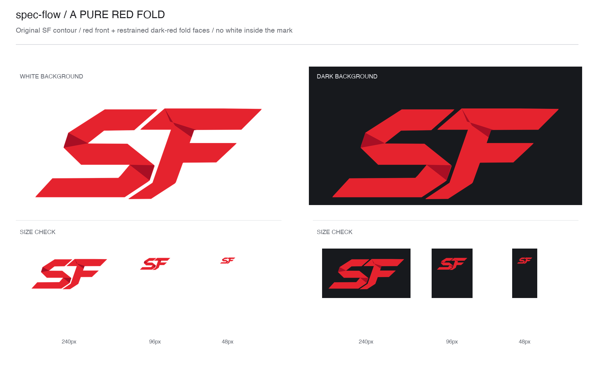

# spec：纯红折叠 SF logo 定稿与替换

- 日期：2026-10-21
- Issue：#107
- 状态：实施验收通过，待实施审核与合并；规格 PR #106
- 生效 ADR：本仓未声明采用 ADR，本次不新增采用机制

## 已确认需求与依据

现有标志为黑色 SF。用户希望改为红色，并让 S 的折叠感与较平面的 F 协调。

上一轮已比较 A / B / C 方向，以及在字母内部加入白色翻面的细化稿。用户最终在方向卡明确说：

> 哈哈，都不好看，还是纯红色的那一版A吧

随后制作第三轮矢量稿：保留原始 SF 外轮廓，用主红和 3 处暗红折回面表现折叠，不在字母内部加入白色。恢复会话时向用户展示该稿及白底、深底、240 / 96 / 48px 对比；用户回复：

> 是的是的，就这样

本次以该第三轮稿为视觉基准，不再探索红白翻面或重新生成不同轮廓。

- [矢量基准](assets/2026-10-21-red-fold-logo.svg)，SHA-256：`0570755a1fa99ec4edad7750ca876a3d4a980cf178bdf9cbf1e93f734ba8a237`。
- 上图 SHA-256：`7011e7c2d1ffc20c0e58329a4125f2853b2b3a17ffa99e51ace21223c81b35b6`。
- 这两份是规格附件，不是已经替换的正式资源；最终 SVG 的标题等元信息可去掉草稿用语，图形与色值不变。

上一轮于 2026-10-21 实际下载过官方规范：[Red Hat](https://www.redhat.com/en/about/brand/standards/logo)说明红底反白、不加渐变和阴影；[GitLab](https://design.gitlab.com/brand-logo/core-logo)给出留白、最小尺寸和单色变体；[IBM](https://www.ibm.com/design/language/ibm-logos/8-bar/)提醒反白版本需考虑视觉粗细。本次只借鉴少色、平面和分别核对背景的做法，不复制品牌形状，也不把其他品牌的尺寸要求套给 SF。

## 现状与目标

在基线 `e2f773b` 核对：

- `assets/logo/spec-flow.svg` 是 2 条黑色填充路径，`viewBox="119 400 1016 436"`；白色变体使用相同路径和变换。
- `assets/logo/manifest.json` 记录原始生成稿 C、轮廓矢量化来源、黑色透明底，以及宽 2048px、高 879px 的 PNG 导出。
- 两份 README 顶部均以宽 480px 引用默认 SVG，深色模式通过 `picture/source` 切换白色 SVG。

唯一交付目标：将已确认的纯红折叠标志作为两种主题下的默认正式 logo，资源、导出和来源记录一致。

## 机制清单

无新增机制。复用现有 SVG、PNG、来源清单与 README 展示方式；不新增工作流、脚本入口、依赖或采用项。

## 设计约束

- 直接沿用附件的 S / F 路径、`transform`、画布和相对位置，不重描、不变形、不加外框或字标。
- 主红为 `#E5232E`，暗红为 `#A80F24`；只保留附件里的 3 处暗红折回面及其裁剪几何。
- 透明背景；白色只来自背景和字母留白，不作为字母内部的独立填充面。不要黑色、描边、渐变、阴影或立体渲染。
- 白底、深底均使用同一红色标志。不得继续让 README 在深色模式切回白色默认标志。
- 保留现有白色单色资源，作为备用变体；不删除旧来源图，不改历史规格，不清理未跟踪的旧草图。

## 改动面与边界

| 文件 | 允许的变化 |
|---|---|
| `assets/logo/spec-flow.svg` | 按附件替换为正式红色 SVG；保留可访问标题，无外部资源引用 |
| `assets/logo/spec-flow.png` | 从正式 SVG 重新导出透明 PNG，沿用 2048 x 879 尺寸 |
| `assets/logo/manifest.json` | 更新当前方案、配色、正式 SVG 来源和导出记录，明确原始 C 图只证明轮廓来源；保留原来源和矢量化历史 |
| `README.md` / `README.zh-CN.md` | 仅同步调整顶部展示，使明暗主题均显示默认红色 SVG，宽度与替代文字不变 |
| 本 spec 的 Issue / 状态 / 审核记录 | 按既有流程回填，不改设计约定 |

不碰 `SKILL.md`、`references/`、检查脚本、安装配置、旧规格正文、白色 SVG 和原始 C 图片。本规格附件随规格保留，实施不重绘或替换附件来掩盖正式稿差异。

## 体量评估与结构选择

本次只有一个交付成果：默认 logo 完整替换。导出、来源记录和双语展示是同一成果的配套部分，普通核对、导出、测试与提 PR 不算多个交付阶段。没有独立部署、迁移或长期观察阶段，也没有其他执行单的前置依赖。

推荐不拆：保留 1 份执行 spec 和 1 张执行 issue，同批更新资源与展示，避免中途只换图片却继续展示白色版。

可选拆法：S01 负责正式 SVG / PNG 与来源记录，S02 负责双语 README 展示和整体效果核验；另需 1 份总纲、2 份执行 spec、2 张执行 issue 与 1 张仅跟踪父 issue。S02 的展示约定可先写，但整体核验及发布需消费 S01 的正式资源；不宣称二者可完全独立发布。

用户在结构卡选择“不拆（推荐）”：按 1 份执行 spec 和 1 张执行 issue 交付；资源、导出、来源记录及双语展示同批完成，不新增多阶段安排。可选拆法仅保留为比较记录。

## 验收标准

- [x] 正式 SVG 与附件保留相同的 S / F 轮廓、位置和 3 处裁剪折面，只有已说明的非视觉元信息可变。
- [x] SVG 只用规定的两种红色；透明底，无白色填充、描边、渐变、滤镜、脚本或外部依赖。
- [x] PNG 为从正式 SVG 导出的 2048 x 879 透明图；提供图形边界、非空前景和透明留白的核对结果。
- [x] 来源记录指向实际存在的文件，当前配色和导出信息准确；原始 C 来源和轮廓矢量化历史不冒充红色稿的直接生成参数。
- [x] 双语 README 顶部在明暗主题均引用正式红色资源，宽 480px，替代文字仍为 `spec-flow`；正文及节标记不变。
- [x] 核对正式资源在白底、深底及 240 / 96 / 48px 宽时非空、无意外裁切、图形一致；这些尺寸只用于视觉对照，不宣称已经验证 favicon 可读性。
- [x] `bash scripts/check-docs.sh` 与 `git diff --check` 通过；实际变更没有越出上述范围。
- [x] 提供正式 SVG / PNG 和展示核验结果；无未处理的已知阻断缺陷，不以持续观察作为关单条件。

## 自定细节

| 细节 | 理由 |
|---|---|
| 沿用当前正式文件名、尺寸和 README 宽度 | 避免无关链接变更和版面调整 |
| 两种主题共用红色稿，旧白色稿只保留备用 | 已确认的第三轮对比同时展示两种背景；避免深色下仍显示旧方案 |
| 规格保存原始附件并记录散列值 | 让后续实施可核对确认稿，而不依赖临时目录或仅凭会话描述 |
| 不新增导出工具链或仓内检查入口 | 这次是图形资源更新；用实际可用工具导出并报告验证，不扩展为维护构建系统 |

## 审核修订记录

规格期：用户在本份审核卡选择“不审”。主会话已核对实际 diff：仅新增本 spec 与 2 份视觉附件；附件 SHA-256 与恢复出的第三轮原稿一致。`bash scripts/check-docs.sh` 与差异检查通过，正式 logo、双语 README、工作流规则及其他文件均未改动。实施仍须按本 spec 验收，并另过实施期审核闸。

实施验收：正式 SVG 与确认附件的 XML 图形树一致，只改标题和描述；CairoSVG 2.9.1 导出的 PNG 为 2048 x 879 RGBA，非透明边界为 `(48, 48, 2000, 831)`，像素与正式 SVG 及确认附件的同尺寸渲染完全一致。来源路径、散列值、配色和历史字段已核对，白色备用稿、原始 C 图及规格附件未改动。

Playwright 1.63.0 / Chromium 本地 README 头部夹具检查：中英文 x 明暗主题 x 桌面 1280 x 900 / 手机 375 x 812，共 8 组通过；桌面显示宽 480px，手机由页面图片约束收至 343px，无横向溢出。240 / 96 / 48px 均与确认稿逐像素一致、非空且无边界裁切。夹具不是 GitHub 在线页面，不宣称 favicon 可读性或其他浏览器已经验证。

`bash scripts/check-docs.sh` 与差异检查通过；实际 diff 只包含获准的 6 份文件。实施期审核档位待用户当场选择，未沿用规格期选择。
